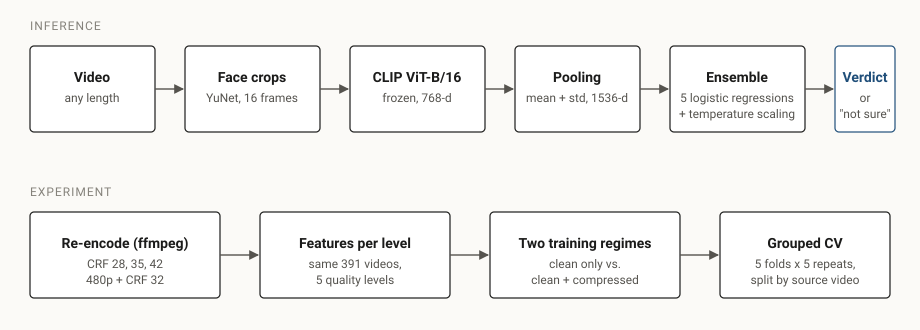
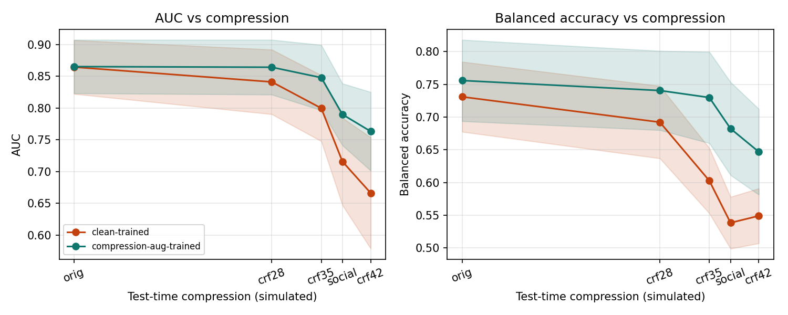
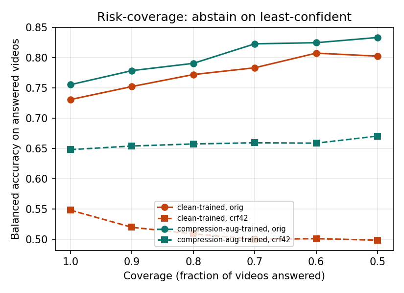

# Compression-Robust, Calibrated Deepfake Detection

How much does platform-style video compression hurt a deepfake detector, can
compression-aware training recover the loss, and can the detector say "not sure"
instead of guessing?

Most deepfake detectors are evaluated on clean, high-quality video. Videos shared
online are re-encoded and downscaled, which removes the fine-grained traces many
detectors depend on. This project quantifies that drop on the DFDC sample under
simulated re-encoding, tests a simple mitigation, and studies calibration and
abstention as the way a deployed detector should handle inputs it cannot judge.



## Demo

Screen recording of the web app analysing DFDC clips. The clips come from the DFDC training sample, so the final model has seen them; they show how the interface behaves, and the held-out evidence is in the results below.

## Findings

Evaluation: 391 DFDC videos (77 real, 314 fake), 5-fold cross-validation grouped by
source video, repeated 5 times. Mean AUC ± standard deviation across folds and repeats.

| Test condition | Trained on clean video | Trained with compression augmentation |
|---|---|---|
| Original | 0.864 ± 0.042 | 0.865 ± 0.042 |
| CRF 28 | 0.841 ± 0.051 | 0.864 ± 0.043 |
| CRF 35 | 0.800 ± 0.052 | 0.848 ± 0.051 |
| 480p + CRF 32 ("social") | 0.716 ± 0.069 | 0.790 ± 0.049 |
| CRF 42 | 0.666 ± 0.087 | 0.763 ± 0.062 |



1. **Compression degrades the detector sharply.** A detector trained only on clean
   video falls from 0.864 AUC to 0.666 at CRF 42, close to chance in balanced accuracy (0.549).
2. **Compression-aware training recovers part of the loss.** Training on clean plus
   re-encoded copies lifts AUC at CRF 42 from 0.666 to 0.763 and on the 480p+CRF 32
   chain from 0.716 to 0.790, with no cost on uncompressed video (0.864 vs 0.865).
   The standard deviations overlap at several levels, so these are consistent trends on a
   small dataset, not tight estimates.
3. **Abstention helps on clean video and barely on heavily compressed video.** For the
   augmented model on original video, balanced accuracy rises from 0.756 (all videos) to 0.833 when
   it answers only its 50% most confident cases. At CRF 42 it rises from 0.648 to 0.671.
   For the clean-trained model on compressed video, confidence carries almost no information.

   

4. **Calibration is imperfect.** Temperature scaling (fitted T = 1.52, i.e. the ensemble is
   overconfident) reduces expected calibration error under heavy compression (CRF 42: 0.174
   to 0.144 for the clean-trained model) but does not help on clean data (0.097 raw vs
   0.103 calibrated). ECE stays around 0.1 throughout.

Full tables: [`results/results.md`](results/results.md), raw numbers: [`results/results.json`](results/results.json).

## Method

- **Faces.** YuNet (OpenCV) finds the largest face in each of 16 evenly spaced frames; crops are 224x224 with 30% padding.
- **Features.** A frozen CLIP ViT-B/16 vision tower (OpenAI, via Hugging Face `transformers`) embeds each crop (768-d). Embeddings are pooled over frames as mean and standard deviation (1536-d). The backbone is not trained.
- **Head.** A bagged ensemble of five L2-regularised logistic regressions (C = 0.05, balanced class weights), each fit on a group bootstrap of the training videos.
- **Calibration and abstention.** Temperature scaling is fitted on held-out videos from separate source groups. The verdict is "uncertain" when calibrated confidence max(p, 1-p) is below 0.65. Member disagreement is reported as a second uncertainty signal.
- **Interpretation.** Leave-one-frame-out influence shows which sampled frames pushed the verdict toward fake or real. It does not localise artifacts within a frame.

### Evaluation protocol

- **Grouped splits.** DFDC fakes are generated from original videos. Each original and all fakes derived from it form one group and are never split across train and test, which prevents the model scoring well by recognising a person or scene.
- **Simulated compression.** Each video is re-encoded with ffmpeg (libx264, `veryfast`) at CRF 28, 35 and 42, plus a chain that downscales to 480p and encodes at CRF 32. Faces are re-detected on the degraded frames. This approximates, but does not replicate, the pipelines of specific platforms.
- **Training regimes compared.** Clean-only versus clean plus all compressed copies, each tested at every level.
- **Metrics.** AUC, balanced accuracy, expected calibration error (10 bins, with and without temperature scaling), risk-coverage curves.

## Scope and next steps

- **Sample size.** 77 real and 314 fake videos. The results describe trends with wide, partly overlapping intervals. Adding real footage is the first extension.
- **Single dataset.** Training and testing are within DFDC (face swaps). Cross-dataset evaluation on Celeb-DF and FaceForensics++, and on videos from newer generators, is the next experiment.
- **Simulated compression.** Re-encoding uses ffmpeg (libx264) settings. Comparing against real platform re-encodes would test how well the simulation transfers.
- **Split design.** Splits are grouped by source video, but the same performer can appear in different groups, so estimates may be optimistic. A split grouped by identity would tighten this.
- **Face detection.** Videos without a detectable face are rejected. Of the 400 videos in the DFDC sample, 391 yielded faces at every compression level and form the evaluation set.
- **Use.** Output is a model estimate for research, not forensic evidence.

## Repository layout

```
v2/make_manifest.py   DFDC metadata -> manifest (path, label, group)
v2/faces.py           face detection and frame sampling
v2/embed.py           frozen CLIP feature extractor
v2/extract.py         manifest -> per-frame features, optionally after re-encoding
v2/headmodel.py       pooling, ensemble head, temperature scaling
v2/pick_demo_clips.py out-of-fold predictions, to choose demo clips
v2/evaluate.py        grouped cross-validation, metrics, plots, final model
v2/serve.py           FastAPI inference service
ingestion/            YouTube and upload resolution for the service
notebooks/            the pipeline as run on Kaggle (GPU T4)
docs/                 pipeline diagram
frontend/app.html     single-page front end
results/              tables, plots and the trained head (model.joblib)
```

## Reproduce

Feature extraction was run on a Kaggle GPU notebook with the DFDC `train_sample_videos` data; `notebooks/kaggle_pipeline.ipynb` contains the exact commands. Evaluation then runs on CPU in a few minutes:

```bash
pip install -r requirements.txt
python -m v2.evaluate --features_dir feats --out_dir results --seeds 5 --save_model results/model.joblib
```

## Run the demo locally

```bash
pip install -r requirements_serve.txt
pip install torch --index-url https://download.pytorch.org/whl/cpu
MODEL_PATH=results/model.joblib uvicorn v2.serve:app --port 8000
```

Set `API_URL` near the bottom of `frontend/app.html` to `http://localhost:8000` (or open the page with `?api=http://localhost:8000`) and open it in a browser. A `Dockerfile` is provided for container deployment; the service exposes `/health` and `/predict`.

Environment variables: `MODEL_PATH`, `ABSTAIN_BELOW` (default 0.65), `ALLOWED_ORIGINS`, `MAX_UPLOAD_MB`, `LOW_MEM=1` (bfloat16 CLIP for memory-limited hosts).

## Data

The DFDC sample is used under the Kaggle competition rules and Meta's dataset terms; the data is not redistributed here. Treat the project as non-commercial research.CLIP weights are from OpenAI (`openai/clip-vit-base-patch16`); YuNet is from OpenCV Zoo (MIT).

## Notes

Developed with AI coding assistance. Experimental design decisions, runs and analysis are the author's.
